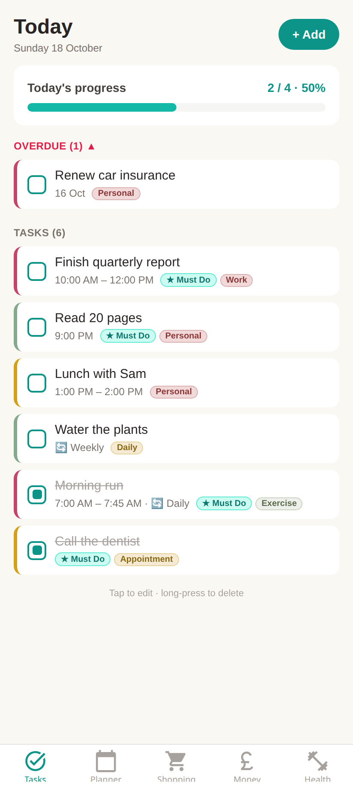
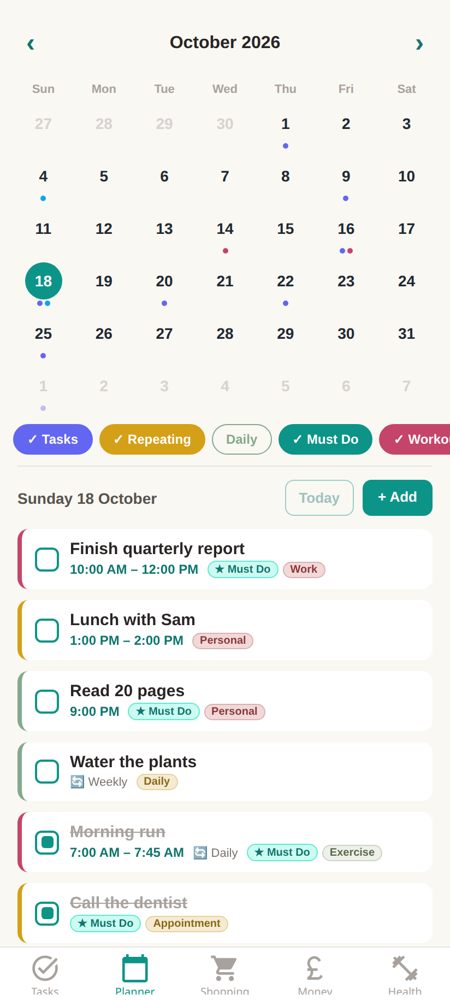
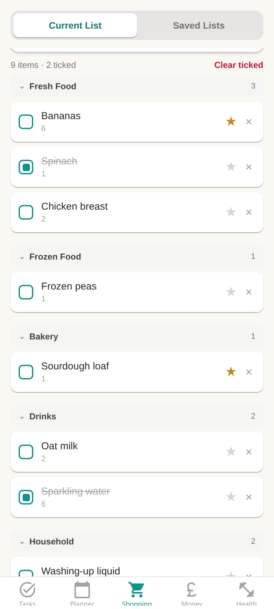
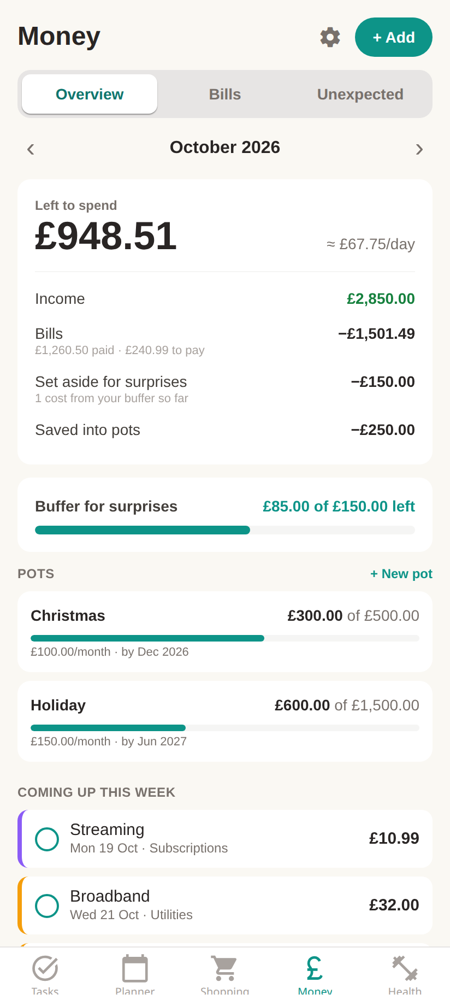
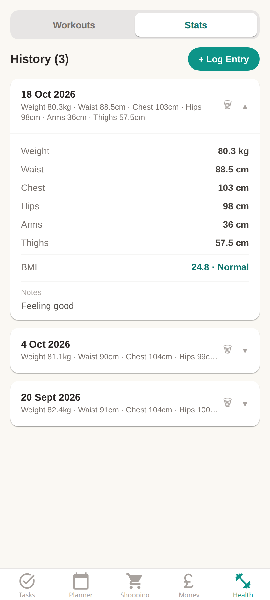

# MyPlannerApp

A personal planner for Android and iOS, built with Expo and React Native. It keeps your tasks, calendar, shopping lists, bills and fitness tracking in one app.

<p align="center">
  
  
  
  
  
</p>

## Features

### ✅ Tasks
- Today view with a **Must Do** progress bar showing how many of today's key tasks are done
- Priorities (low / medium / high), shown as a coloured edge on each card
- Start and end times, notes and tags
- Repeating tasks (daily, weekly, monthly)
- Overdue section for unfinished tasks from earlier days
- Reminder notifications for any task with a start time
- Tap a card to edit it, long-press to delete

### 📅 Planner
- Monthly calendar with coloured dots for tasks, workouts and health entries
- Filter chips you can toggle on and off independently: Tasks, Repeating, Daily, Must Do, Workouts and Health. The app remembers your choice.
- Upcoming repeats of recurring tasks appear on future dates
- Add, edit and tick off tasks for the selected day

### 🛒 Shopping
- Shopping list grouped by category (Fresh Food, Frozen Food, Bakery, Drinks, Household, Other)
- Quick-add from a catalogue of common items, favourites, and things you've bought before
- Save lists with an optional delivery date and reload them later
- Import a list from a `.txt` or `.csv` file

### 💷 Money
- Monthly overview of what's left to spend after income, bills, unexpected costs and savings
- Bills, subscriptions and income that repeat weekly, fortnightly, every 4 weeks, monthly, quarterly or yearly
- Tick off bills as you pay them, with optional reminders before they're due
- Log unexpected costs and set aside a monthly buffer to cover them
- Savings pots with a target amount and date

### 💪 Health
- Workout builder with an exercise catalogue, sets, reps and weight
- Save workouts to history, or save them as reusable routines
- Body stats log for weight, waist, chest, hips, arms and thighs, with automatic BMI
- Daily step count and history from **Android Health Connect**, with a step goal

### 🌙 General
- Light and dark mode that follow your system setting
- Haptic feedback on tab presses

## Tech stack

| | |
|---|---|
| Framework | [Expo](https://expo.dev) SDK 54, React Native 0.81, React 19 |
| Navigation | [Expo Router](https://docs.expo.dev/router/introduction/) (file-based tabs) |
| Styling | [NativeWind](https://www.nativewind.dev/) (Tailwind CSS) |
| Storage | AsyncStorage on the device. Nothing is sent to a server. |
| Validation | [Zod](https://zod.dev) |
| Health data | [react-native-health-connect](https://github.com/matinzd/react-native-health-connect) |
| Notifications | expo-notifications |
| Builds and updates | EAS Build and EAS Update |

## Getting started

### Prerequisites
- Node.js 20 or newer and npm
- [EAS CLI](https://docs.expo.dev/eas/) (`npm install -g eas-cli`) if you want to make builds
- An Android device or emulator, or an iOS simulator

### Install

```bash
git clone https://github.com/Rotberg/my-planner-app.git
cd my-planner-app
npm install
```

No environment variables or database setup are needed. All data is stored on the device, so it doesn't sync between devices and is lost if the app is uninstalled.

### Run

```bash
npm start          # start the Expo dev server
npm run android    # open on Android
npm run ios        # open on iOS
npm run lint       # run ESLint
```

> **Note:** Step tracking uses native modules (Health Connect), so it doesn't work in Expo Go. Use a development build for the full app:
>
> ```bash
> eas build --profile development --platform android
> ```

## Building and releasing

Build profiles are defined in [`eas.json`](eas.json):

| Profile | Output | Channel |
|---|---|---|
| `development` | Dev client, internal distribution | `development` |
| `preview` | Installable Android APK | `preview` |
| `production` | Store build, version number goes up automatically | `production` |

```bash
eas build --profile preview --platform android    # build an APK to share
eas update --channel preview                      # push an over-the-air JS update
```

## Project structure

```
app/                 Expo Router routes
  (tabs)/            Tasks, Planner, Shopping, Money and Health tabs
screens/             Full screen components for each tab
components/          Shared UI (TaskForm, StepsCard, tab bar pieces)
utils/
  tasks.ts           Task model, storage, recurrence and notifications
  steps.ts           Health Connect step tracking
  notifications.ts   Notification setup
  storage.js         AsyncStorage helpers
  localDb.ts         On-device tables for shopping lists, workouts and body stats
  shoppingHistory.ts Shopping suggestion history
constants/           Theme colours
hooks/               Colour scheme hooks
docs/                Design specs and README screenshots
```

## Platform notes

- **Step tracking is Android only.** It reads step data from Health Connect, which collects it from Google Fit, Samsung Health, Fitbit and similar apps. The app asks for read access to steps and nothing else. The minimum Android SDK is 26.
- iOS supports everything except step tracking.
